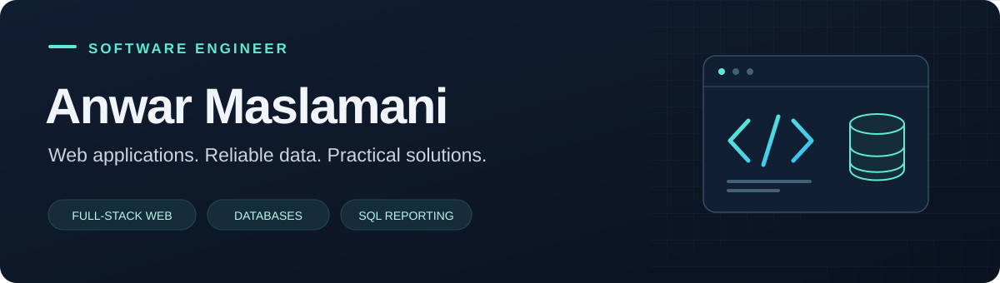

  

  
  

### Building software from interface to database

I'm **Anwar**, a Software Engineering graduate from **Amman Arab University**. I build web applications with **PHP and ASP.NET**, design relational databases, and turn business requirements into useful SQL reports.

My experience spans frontend screens, backend logic, authentication, role-based access, and system-analysis documentation.

---

### Selected work

<table>
  <tr>
    <td width="50%" valign="top">
      <h3>01 · MyRoad</h3>
      
<strong>Vehicle &amp; traffic services platform</strong>

      
Graduation project for vehicle registration, licence renewal, ownership transfers, appointments, and traffic violations.

      
<code>PHP</code> <code>MySQL</code> <code>JavaScript</code>

      
<strong>My role:</strong> Full-stack developer in a team of three. Built frontend and backend features, authentication, role-based access, and system diagrams.

    </td>
    <td width="50%" valign="top">
      <h3>02 · Business ERP</h3>
      
<strong>ERP foundation for small businesses</strong>

      
An academic team project connecting application development, database work, and organized delivery.

      
<code>ASP.NET</code> <code>SQLite</code> <code>Agile</code>

      
<strong>My role:</strong> Team leader. Coordinated tasks and the team, applying Agile practices to support delivery.

      
<a href="https://github.com/Billzer468/DataBaseProject-V1.O"><strong>Explore the repository →</strong></a>

    </td>
  </tr>
</table>

### My toolkit

  
  
  
  
  
  
  
  

**Analysis &amp; delivery** · Requirements gathering · ER diagrams · Use cases · Data flow diagrams · Agile &amp; Scrum

**Tools &amp; reporting** · Visual Studio Code · GitHub · XAMPP · SQL business reports · RTF report templates

### Experience & learning

- **Technical Consultant Intern** · Jul–Sep 2026 Developed SQL queries, business reports, and Microsoft Word RTF report templates.
- **B.Sc. Software Engineering** · Amman Arab University · 2022–2026
- **Jordan Gaming Lab Hackathons** · Contributed to building and testing game features at two team events.

  
<strong>Certifications &amp; training</strong>

   
  <ul>
    <li>IC3 Digital Literacy Certification · Certiport · 2026</li>
    <li>ASP.NET Core Training · Pioneers Academy · 2025</li>
    <li>CCNA Training · Pioneers Academy · 2026</li>
    <li>Linux Course · Amman Arab University</li>
  </ul>

---

<strong>Let's connect.</strong> Find my professional background and updates on <a href="https://www.linkedin.com/in/anwar-maslamani">LinkedIn</a>.

